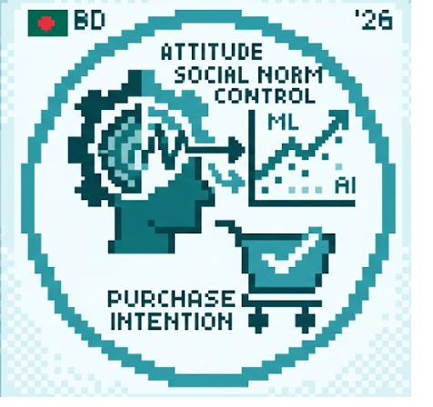

# CogD-ML

Code and data for *Cognitive Determinants of Social Commerce Purchase Intention
in Bangladesh Using Machine Learning and Explainable AI* (PLOS ONE,
PONE-D-25-67629).

The study measures Theory of Planned Behavior constructs on 352 Bangladeshi
social commerce users, fits eight classifiers, explains them with SHAP and
LIME, and checks whether the fitted signal transfers to an unrelated sample.

## Quick start

```bash
pip install -r requirements.txt
pip install -e .
python test_reproduce.py
./run_all.sh
```

Every table in the paper lands in `outputs/` as a CSV named after it.
`run_all.sh` skips `08_llm_ablation.py`, which needs a GPU.

## Layout

```
cogdml/          data loading, model definitions, metrics
scripts/         one script per analysis, numbered in run order
prompts/         serialisation and system prompts for the appendix
data/            survey data, plus provenance for the external sample
docs/            language model settings
outputs/         generated
```

| Script | Produces |
|---|---|
| `01_measurement.py` | Reliability, HTMT, construct correlations |
| `02_ablation.py` | Construct-subset ablation across eight classifiers |
| `03_crossval.py` | Five-fold cross-validation and paired tests |
| `04_thresholds.py` | Threshold sensitivity and Youden analysis |
| `05_crossdomain.py` | Transferability check |
| `06_hypotheses.py` | Pathway tests and multivariate model |
| `07_explain.py` | SHAP ranking and a LIME instance |
| `08_llm_ablation.py` | Appendix language model ablation (GPU) |

## Reproducibility

Seed 42 throughout. Versions are pinned in `requirements.txt`; results were
produced on Python 3.12.3 with the pinned versions. `run_all.sh` sets
`PYTHONHASHSEED=0`.

Construct membership is defined once, in `cogdml/data.py`, and every script
imports it. This matters more than it looks: `PBC1` also starts with `PB`, so
selecting outcome columns by prefix pulls Perceived Behavioral Control items
into the outcome while they are also being used as predictors. Earlier versions
of this analysis did exactly that. `test_reproduce.py` fails if it happens
again.

## Data

The survey data is ours, collected under North South University ethics
approval, and ships with the repository. It contains no names, contact details,
IP addresses, dates or free text, so no separate anonymisation step exists.

The external sample is Rakesh Kumar's, published on Mendeley Data
(doi:10.17632/b9hdy2swyy.1). We do not redistribute it. Run
`./fetch_external.sh` before `05_crossdomain.py`, or download it manually into
`data/`.

See `data/README.md` for the codebook and the mapping caveats.

## Citing

See `CITATION.cff`. If you use this software or data, please cite the article.

## License

MIT for the code. 
